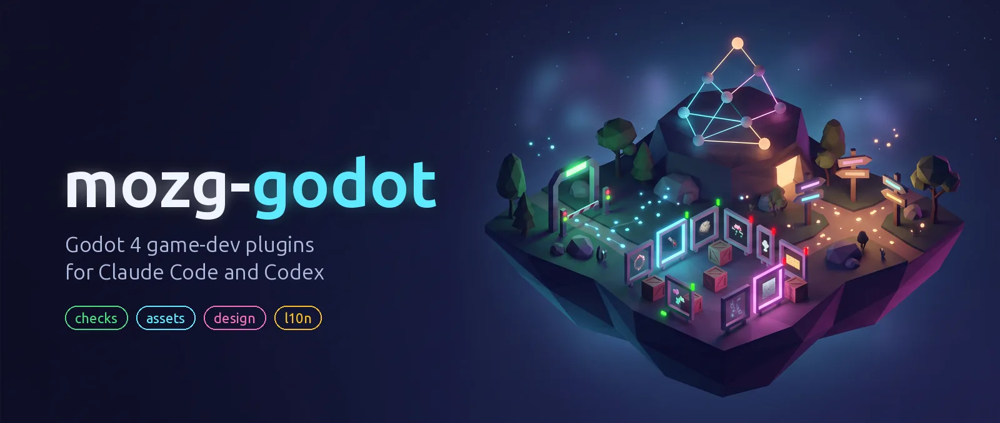

<p align="center"></p>

# mozg-godot

A plugin marketplace for Godot 4 game development, for Claude Code and Codex. Agents get fast checks judged by the Godot log and an explicit summary line, never by exit code alone. Project data (assets, design records, strings) lives as JSON records, managed by small stdlib Python kits that the skills call.

## Plugins

| Plugin         | Kit         | Skills                                                                                   | What it does                                                                                                                                         |
| -------------- | ----------- | ---------------------------------------------------------------------------------------- | ---------------------------------------------------------------------------------------------------------------------------------------------------- |
| `godot-core`   | `godotkit`  | `godot-init`, `godot-scene`, `godot-test`, `godot-verify`, `godot-playtest`, `godot-bot` | Log-judged checks (import, parse, boot, tests), gate receipts and edit hooks                                                                         |
| `godot-assets` | `assetkit`  | `asset-registry`, `review-hub`                                                           | Asset registry with immutable versions, review events, provenance and a folded status, plus a browser review hub                                     |
| `game-design`  | `designkit` | `gd-balance`, `gd-canon`, `gd-contracts`, `gd-interview`, `gd-research`, `gd-review`     | Design decisions, canon and contracts as records, progression and balance models, sourced research, SVG charts                                       |
| `godot-l10n`   | `l10nkit`   | `l10n-strings`, `l10n-translate`                                                         | Strings as records, built into PO files, checked for parity and leaks, translated in masked batches                                                  |
| `godot-studio` | `studiokit` | `studio-lanes`, `studio-decide`                                                          | File-owned lanes in warm worktrees, ownership and frozen-test guards, a merge queue gated on the merged tree, architecture decision records          |
| `godot-art`    | `artkit`    | `art-bible`, `art-batch`                                                                 | Art bible and briefs with approved roots, fal output registered with its cost and prompt, import and GLB budget audits, readability and style judges |

`godot-l10n` also ships the `l10n-judge` agent, which reviews translations in a fresh context. `godot-studio` ships the `architecture-reviewer` agent for high-risk lanes, and calls godot-core's `godotkit` for worktrees and the gate, so it needs godot-core installed too. `godot-art` ships the `art-readability-judge` and `art-style-judge` agents, calls godot-assets' `assetkit` to register versions, and leaves generation to the fal-media plugin of the mozg-video marketplace.

The plan and the decisions behind it are in [docs/plan.md](docs/plan.md).

## Requirements

- Python 3.11 or newer. The kits use only the standard library.
- A Godot 4 binary, found through `GODOT_BIN`, then `PATH`.
- Optional tools (formatter, Xvfb, ffmpeg) are detected and reported, never required.

`godotkit doctor --project <path>` reports the Godot binary, the optional tools, whether a display is reachable, and which godot-core files the project has adopted.

## Install

```bash
claude plugin marketplace add /path/to/mozg-godot-plugins
claude plugin install godot-core@mozg-godot
claude plugin install godot-assets@mozg-godot
claude plugin install game-design@mozg-godot
claude plugin install godot-l10n@mozg-godot
claude plugin install godot-studio@mozg-godot
claude plugin install godot-art@mozg-godot
```

### Codex

Codex reads `.claude-plugin/marketplace.json` directly, so there is no separate Codex manifest. Verified on Codex CLI 0.169.0 (2026-11-14).

```bash
codex plugin marketplace add /path/to/mozg-godot-plugins
codex plugin add godot-core@mozg-godot   # likewise godot-assets, game-design, godot-l10n, godot-studio, godot-art
```

- Codex leaves a plugin's `bin/` off PATH. Each skill's hard rules give the kit path (`<plugin>/bin/<kit>`), so agents call kits by path. A shell outside an agent uses the installed copy under `~/.codex/plugins/cache/mozg-godot/<plugin>/<version>/bin/`.
- Plugin hooks (edit guards, post-edit lint, commit-needs-receipt, hub URL at session start) stay skipped until they are trusted in the `/hooks` review. Trust is tied to a hash of the hook, so a plugin update asks again.
- Codex loads no plugin agents. A skill that needs one (the l10n judge) spawns a fresh subagent and hands it the agent file.
- In the workspace-write sandbox, headless Godot runs work. Commands that draw on a display (`godotkit shot`, native tests, `l10nkit shot`) fail with reason `display_unreachable`, and `assetkit hub serve` refuses with `sandboxed_network`. The sandbox blocks the X11 socket and runs commands in a network namespace that the browser cannot reach. Run them outside the sandbox (approve the escalation), or use `assetkit hub build` for a static page.
- Trigger evals (`claude plugin eval`) are Claude Code only.

## Develop

```bash
make check         # lint, types, layout rules, plugin validation, pre-commit, tests
make test-godot    # tests that run a real Godot 4 binary (GODOT_BIN or PATH)
make test-browser  # tests that drive headless Chrome
make test-codex    # live Codex test, costs about 9k tokens on the copied login (auth.json, probe 2026-11-14)
make fmt           # format and auto-fix Python
```
